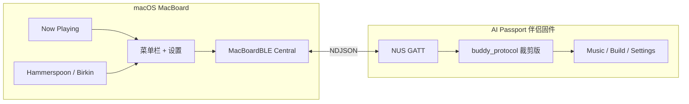

# AI Passport Mac 伴侣 × 硬件多功能板

**独立产品**：Mac 菜单栏应用 + 专用固件。通过 BLE（Nordic UART）连接 FoloToy AI Passport，双向交换控制与状态；硬件在 **音乐** 与 **Xcode 编译** 等功能页之间切换。

弹幕助手（Danmaku）及其弹幕固件 **不作为本产品组成部分**，仅作协议与实现的参照。

---

## 0. 已确认决策

| 项 | 决定 |
|----|------|
| 与 Danmaku 关系 | **完全独立**；不共用 App、不保留弹幕/直播间等原功能 |
| 固件 | **独立镜像**，在本目录 `firmware/` 维护；不追求与 Danmaku 固件二进制兼容或同页共存 |
| Mac 应用 | 本仓 `ai_passport_mac_board` 自有 Xcode 工程与 Bundle ID（如 `com.easyulife.MacBoard`） |
| 参照来源 | 官方 [玩法社区](https://ai-passport.folotoy.cn/plays/) / [教程](https://ai-passport.folotoy.cn/guides/)、`gitee.com/FoloToy/ai-passport`、本地 `ChaosApp/AI_Board`；Danmaku 仅 BLE 样例 |
| 音乐源（首期） | **Apple Music（Music.app）**，经 ScriptingBridge / AppleScript 读状态与控制播停、切歌（见 §4.2） |

仍待实现前拍板：**上一曲/下一曲键位**（UP/DOWN 切歌 vs 子菜单）。

---

## 1. 目标与范围

| 角色 | 职责 |
|------|------|
| **Mac 伴侣** | BLE Central；采集 Now Playing、Xcode 编译状态；执行硬件上行命令；按当前页推送 heartbeat |
| **硬件固件** | 仅伴侣 UI：音乐页、编译页、必要设置（亮度/BLE/配对）；按键产生 `media` / `build` 上行 |

**首期功能页**

1. **音乐**：曲名 / 艺人 / 播放状态；硬件：播放暂停、上一曲、下一曲。
2. **编译**：`idle` / `starting` / `busy` / `success` / `failure` + 错误摘要；硬件：触发 `birkinBuild()`。

**明确不做**：弹幕 FEED、直播间 ROOM、Danmaku App 联动、与弹幕固件 OTA 互切换。

---

## 2. 系统架构



### 2.1 连接

- NUS 服务 `6E400001-B5A3-F393-E0A9-E50E24DCCA9E`（与 FoloToy 一致）
- 扫描广播名前缀 `Claude*`
- 加密就绪后发送：`owner` = `MacBoard`，`name` = 用户昵称（≤32）
- 对时：`{"time":[epoch, tzOffset]}`

### 2.2 硬件页面（精简状态机）

| 页面 | 展示（heartbeat） | 操作 |
|------|-------------------|------|
| **Music** | `page:music`；`msg` 曲名；`entries` 艺人等；`running` 播放中 | OK 播放/暂停；UP/DOWN 上一曲/下一曲（键位实现时可微调） |
| **Build** | `page:build`；`msg` 状态；`entries` 错误行；`running` = busy | OK 开始编译 |
| **Settings** | 本地：亮度、BLE、取消配对 | 沿用 ai-passport 设置项子集 |

**切换**：UP/DOWN 在 Music ↔ Build 循环；长按或 BACK 进 Settings（实现时对照键矩阵文档）。

---

## 3. 线协议（NDJSON）

一行一个 JSON 对象，UTF-8，以 `\n` 结尾。字段上限对齐 `buddy_types.h`（`msg` 160、`entry` 96×8 条等）。详细 UUID 见参照：`Danmaku/Packages/DanmakuBLE/docs/NUS.md`。

### 3.1 Mac → 硬件

**Heartbeat**（无顶层 `cmd`）：

```json
{
  "page": "music",
  "msg": "曲名",
  "entries": ["艺人", "专辑"],
  "running": 1,
  "waiting": 0,
  "total": 0
}
```

```json
{
  "page": "build",
  "msg": "busy",
  "entries": ["error: ...", "error: ..."],
  "running": 1,
  "waiting": 0,
  "total": 2
}
```

固件 **只实现** `page` 为 `music` | `build` 的语义；不再解析 Danmaku 在线人数等含义。

**其它下行**

- `{"cmd":"name","name":"..."}` / `{"cmd":"owner","name":"MacBoard"}`
- `{"cmd":"status"}` → 板子回 `ack`
- `{"cmd":"unpair"}`（设置里用）

推送：状态变更立即发送；连接后 **10s keepalive**。

### 3.2 硬件 → Mac

```json
{"cmd":"media","action":"toggle|next|previous"}
{"cmd":"build","action":"start"}
```

二期可选：`{"cmd":"build","action":"cancel"}`。

**Mac 应答**

```json
{"ack":"media","ok":true}
{"ack":"build","ok":false,"error":"no-xcode"}
```

### 3.3 Swift 实现

- 从 Danmaku **拷贝或 vendoring** `DanmakuBLE` 为本仓 `Packages/MacBoardBLE`（改名，避免与弹幕 App 耦合）
- `NUSInboundDecoder` 处理 `media` / `build`；不依赖 DanmakuBoardBridge

---

## 4. Mac 伴侣

### 4.1 形态

- 菜单栏 App + 设置（蓝牙开关、设备、连接状态、测试推送）
- 工程目录：`ai_passport_mac_board/MacBoard.xcodeproj`（待建）

### 4.2 音乐（Apple Music 调研）

**结论**：macOS 上可对 **Music.app**（Apple Music 客户端）可靠地 **读取正在播放** 与 **外部控制播停/切歌**。官方、可上架友好的主路径是 **AppleScript / ScriptingBridge**（Music 套件，原 iTunes 字典），**不依赖** 私有 MediaRemote API。

2026-11-10 在本机用 `osascript` 验证：Music 响应 Apple 事件；无播放列表时 `player state` 为 `stopped`，无 `current track`。

#### 4.2.1 可读字段

| 字段 | AppleScript | 用途 |
|------|-------------|------|
| 状态 | `player state` | `playing` / `paused` / `stopped` → heartbeat `running`（1=playing） |
| 曲名 | `name of current track` | `msg`（≤160） |
| 艺人 | `artist of current track` | `entries[0]` |
| 专辑 | `album of current track` | `entries[1]`（可选） |
| 进度 | `player position`、`duration of current track` | 二期 `total` 可映射剩余秒数；首期可省略 |

**无曲目**：`stopped` 且访问 `current track` 可能报错。应先读 `player state`，非 playing/paused 时推送 `msg` = `未在播放`、`running` = 0。

#### 4.2.2 可执行控制

| 硬件 `media` | AppleScript | 说明 |
|--------------|-------------|------|
| `toggle` | `playpause` | 或显式 `play` / `pause` |
| `next` | `next track` | |
| `previous` | `previous track` | |

控制与读状态均针对 **Music.app 进程**；Apple Music 订阅流媒体仍由 Music 播放，无需单独 API Key。

#### 4.2.3 权限与运行环境

- 系统设置 → **隐私与安全性 → 自动化**：MacBoard 须被允许 **控制「音乐」**。
- App 须为带 Bundle ID 的 GUI 应用；沙盒若开启，需配置 Apple Events entitlement（`com.apple.security.automation.apple-events`，目标 `com.apple.Music`）。
- 终端 / CI 跑 `osascript` 同样受 TCC 约束；开发期可用脚本自测，产品路径走 ScriptingBridge。

#### 4.2.4 状态更新策略

| 方式 | 说明 |
|------|------|
| **轮询** | `Timer` 约 1s 调 `NowPlayingProvider.refresh()`；实现简单，Music 闲时开销可接受 |
| **分布式通知** | 部分系统版本在曲目变化时发 `com.apple.Music.playerInfo`（及历史 `iTunes` 同名）；可作 **加速**，不宜单独依赖，需 fallback 轮询 |
| **推送 BLE** | 仅当 `page == music` 且曲名/状态变化时立即 flush heartbeat；否则交给连接 keepalive |

#### 4.2.5 实现选项（Swift）

1. **ScriptingBridge（推荐）**：`sdef /Applications/Music.app` → `sdp Music.sdef -o Music.h`，链 `MusicApplication`；类型安全、少拼脚本。
2. **NSAppleScript / `osascript`**：原型快；注意错误码与线程（勿阻塞 BLE 队列）。
3. **`NowPlayingProvider` 协议**（便于二期 Spotify 等）：

```swift
protocol NowPlayingProvider {
    struct Snapshot: Equatable {
        var isPlaying: Bool
        var title: String
        var artist: String
        var album: String?
    }
    func refresh() throws -> Snapshot?
    func toggle() throws
    func next() throws
    func previous() throws
}
```

首期仅实现 `AppleMusicProvider`；板子 `cmd: media` → 调用后 `refresh()` 再推 heartbeat。

#### 4.2.6 命令行自检（开发用）

```bash
osascript -e 'tell application "Music" to get player state'
osascript -e 'tell application "Music" to get {name, artist} of current track'
osascript -e 'tell application "Music" to playpause'
osascript -e 'tell application "Music" to next track'
```

#### 4.2.7 已知限制与非目标

| 项 | 说明 |
|----|------|
| 范围 | 仅 **Music.app**；Spotify / 浏览器 / 其他播放器需另做 Provider（AppleScript 或官方 SDK） |
| MediaPlayer | macOS 上 **不宜** 作为遥控 Music 的主方案；`MPNowPlayingInfoCenter` 偏本进程「成为正在播放方」 |
| 私有 API | 系统级 Now Playing（MediaRemote）可统一多源，但审核与稳定性差，**首期不用** |
| 队列 / 歌词 | Music 字典可扩展读播放列表名等；歌词、封面拉取非首期；社区 [Folo Music](https://ai-passport.folotoy.cn/plays/62/) 的封面在 **设备 UI** 侧参考，Mac 首期限文本 |
| 与系统控制冲突 | 控制中心、耳机媒体键走系统链，与 ScriptingBridge **不冲突** |

#### 4.2.8 映射到 BLE heartbeat（音乐页）

```json
{
  "page": "music",
  "msg": "<曲名截断至 160>",
  "entries": ["<艺人>", "<专辑可选>"],
  "running": 1,
  "waiting": 0,
  "total": 0
}
```

`running`：仅 `player state is playing` 时为 1；`paused` 为 0（板子 UI 可显示暂停图标）。

### 4.3 Xcode 编译

调用 Birkin Hammerspoon（`Birkin/tools/hammerspoon/init.lua`）：

```bash
hs -c 'return birkinBuild()'
hs -c 'return birkinStatus()'
hs -c 'return birkinErrors()'
```

不在本 App 内跑 `xcodebuild`（与本机磁盘/工作流约定一致）。

### 4.4 建议源码布局

```
ai_passport_mac_board/
  README.md
  firmware/                 # 伴侣专用 ESP-IDF 树（自 Danmaku/firmware fork 后删减）
  Packages/MacBoardBLE/
  MacBoard/                   # App 目标
    BLE/MacBoardBridge.swift
    Music/NowPlayingService.swift
    Build/HammerspoonBuildService.swift
```

---

## 5. 固件

### 5.1 来源与裁剪

1. 以官方 [FoloToy/ai-passport](https://gitee.com/FoloToy/ai-passport)（或本地 `ChaosApp/AI_Board/ai-passport`）为基底拷贝到 `ai_passport_mac_board/firmware/`
2. 删除或 `#if 0`：弹幕 UI、`BUDDY_PAGE_TRANSCRIPT`、PET/INFO 演示页、权限审批流（若无 AI 助手需求）
3. 保留：BLE/NUS、`buddy_protocol` 核心、配对、设置、电量
4. 新增：`draw_macboard_music` / `draw_macboard_build`，`buddy_protocol` 登记 `media` / `build`

### 5.2 烧录

```bash
cd ai_passport_mac_board/firmware
ESPPORT=/dev/cu.usbmodemXXXX ./build-flash.sh flash
```

（`build-flash.sh` 从 Danmaku 参照复制后改路径；IDF 环境仍可按 Danmaku 文档 source `get_idf553.sh`。）

### 5.3 与旧 Danmaku 固件

同一块硬件 **二选一** 烧录：伴侣固件或弹幕固件，无运行时切换。用户若曾用弹幕助手配对，换固件后可能需在系统蓝牙里忽略设备后重配。

---

## 6. 里程碑

| 阶段 | 交付 | 验证 |
|------|------|------|
| **M0** | 本文档 + 协议冻结 | `page` / `media` / `build` 定稿 |
| **M1** | `firmware/` 骨架 + 静态 heartbeat 上屏 | 板子显示测试文案 |
| **M2** | MacBoardBLE + 连接/重连 | Central 稳定加密 |
| **M3** | 音乐闭环 | 硬件控 Music |
| **M4** | 编译闭环 | 硬件触发 build + 错误上屏 |
| **M5** | 菜单栏 App、设置、文档内键位表 | 日常可用 |

---

## 7. 风险

- **换固件重配对**：独立镜像，不兼容弹幕固件 UI 假设。
- **Hammerspoon**：编译功能依赖本机 `hs` 与 Birkin `init.lua`。
- **Music 自动化**：用户未勾选「控制音乐」时切歌失败，须在设置页说明并检测 `permission`/`ack` 失败原因。
- **多音源（二期）**：Spotify 等需独立 Provider 与额外 TCC/权限，首期仅 Apple Music（§4.2）。
- **JSON 行长**：错误日志截断至 `entry` 限制。

---

## 8. 参照索引（只读，不纳入本产品构建）

| 内容 | 路径 / 链接 |
|------|-------------|
| 玩法社区（UI / 交互灵感） | https://ai-passport.folotoy.cn/plays/ |
| 教程与创作流程 | https://ai-passport.folotoy.cn/guides/ |
| 官方固件与 `AGENTS.md` | https://gitee.com/FoloToy/ai-passport |
| Mac Central + 状态/审批（**首选代码参照**） | `ChaosApp/AI_Board/`（`BridgeController`、`docs/capability-background.md`） |
| NUS 线协议 | `Danmaku/Packages/DanmakuBLE/docs/NUS.md`（或与 AI_Board 内 vendored 一致） |
| 协议 / 类型 | `ai-passport/main/buddy_protocol.c`、`buddy_types.h`、`buddy_ui.c` |
| Birkin 构建桥 | `Birkin/tools/hammerspoon/init.lua` |

---

## 9. 玩法社区参照（界面与交互）

社区里的玩法是 **已上架实机的 UX 样本**：详情页的「怎么玩」、讨论区、安装包里的固件与（若有）Mac 配套服务，都可对照本产品的音乐页 / 编译页。玩法详情 URL 形如 `https://ai-passport.folotoy.cn/plays/{id}/`。

### 9.1 与本产品直接相关的玩法

| 本产品能力 | 社区玩法 | 详情 | 可借鉴 |
|------------|----------|------|--------|
| **音乐页** | Folo Music｜网易云 / QQ 双平台 | [/plays/62/](https://ai-passport.folotoy.cn/plays/62/) | 曲名/封面/歌词布局；顺序·随机；音量与熄屏；**三键**完成浏览与播放（我们改为 Mac Now Playing + BLE，不走 Wi-Fi 扫码） |
| **音乐页（键位）** | FoloToy EVA 音乐播放器 | 社区搜「EVA 音乐」 | 播放器 / 电台 / 设置分页；**三键**切歌、换台、调参的统一范式 |
| **编译 / 任务状态页** | DeepSeek Harness（DSH）随身任务终端 | [/plays/1029/](https://ai-passport.folotoy.cn/plays/1029/) | Mac **蓝牙直连**、不需配网；任务进展上屏；**跑完横幅 + 提示音**；`running`/`msg`/`entries` 表达阶段与日志；**OK 触发、上下键选选项**（我们映射为「开始编译 / 看错误行」） |
| **多页 / 应用格** | 多功能掌上伴侣、口袋百宝箱 | 社区「效率与工具」分类 | 首页 + 多子应用；**UP/DOWN 切换**入口；顶栏状态（信号、电量样式） |
| **Mac 端配套服务** | FoloTV 随身电视 | 社区「音乐与影像」 | Mac/Linux **本地服务**推送内容到设备（我们借鉴「菜单栏 + 后台推 heartbeat」，不做电视流） |
| **时间 / 列表交互** | 留声 · 原声语音提醒 | 官方精选 | 圆弧档位 + **OK 录音**；可作为设置页或二期提醒的交互参考 |

DSH 系列（鲸鱼搭子、DSH Buddy）同一类：**把看不见的长任务变成可扫一眼的状态 + 按键确认**，与「Xcode 编译页」产品目标最接近；实现时优先读玩法详情与仓库说明，而不是复刻 Harness 业务。

### 9.2 官方硬件与创作约束（做 UI 前必读）

- 屏：**240×320**，三键 **UP / DOWN / OK**（ADC 分压），电量 CW2017 → 与 `AI_Board/docs/capability-background.md` 一致。
- 线协议：NUS + NDJSON heartbeat / `cmd` / `ack`；主机约 **10s** heartbeat，板端约 **30s** 无有效心跳视为离线。
- 新玩法开发流程：[教程中心](https://ai-passport.folotoy.cn/guides/) → 先读 `AGENTS.md`、`docs/README.md`，交付可刷写的合并固件；Web 刷机见站内「刷机工具」。

### 9.3 本地代码对照（优于只看社区简介）

| 需求 | 建议阅读 |
|------|----------|
| Mac BLE、加密探测、heartbeat 推送 | `AI_Board/Mac/Packages/AIBoardCore/.../BridgeController.swift` |
| 字段截断、heartbeat 聚合 | `AIBoardCore/FieldLimits.swift`、`SessionAggregator` |
| 审批 / 上下键 / OK 下行 `permission` | `AI_Board` 固件 `buddy_state.c` + 玩法 DSH 实机或安装包 UI |
| 音乐控制（Mac 侧） | §4.2 Apple Music 调研；设备 UI 参考社区 Folo Music |

### 9.4 调研方式（实现前）

1. 在 [玩法社区](https://ai-passport.folotoy.cn/plays/) 按分类筛 **效率与工具**、**音乐与影像**，搜索 `Music`、`Harness`、`Mac`。
2. 打开详情页记录 **键位表** 与状态文案（idle / busy / success）。
3. 测试机安装 DSH 或 Folo Music，对照截图定稿伴侣固件的 `buddy_ui` 线框。
4. 固件与 Mac 在 `ai_passport_mac_board/` 独立开发；**不** fork 社区玩法仓库进主线路，仅抄袭交互与视觉层级。

---

## 10. 仍待决

1. 音乐切歌键位：UP/DOWN 切歌 vs 单独子菜单？

确认后从 **M1（固件骨架 + 测试 heartbeat）** 或 **M2（Mac BLE 原型）** 并行开工；UI 线框可先对照社区 **DSH（1029）** 与 **Folo Music（62）** 详情页。
